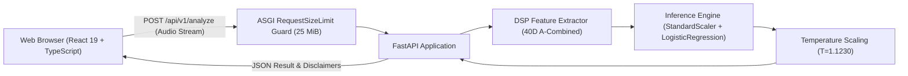

# SYNORA

> **Detecting the Synthetic. Protecting the Real.**

SYNORA is an audio deepfake detection application engineered to analyze speech recordings and detect AI-generated synthetic speech, with research focus on Indian language phonetics and telephony/VoIP transmission channels.

---

## Overview & Capabilities

SYNORA evaluates incoming audio recordings through an end-to-end signal processing and statistical machine learning pipeline:

- **Acoustic Signal Processing:** Ingests raw audio, standardizes sampling rate to 16 kHz mono, applies Voice Activity Detection (VAD), and extracts a 40-dimensional composite acoustic feature representation (A-Combined).
- **Statistical Inference:** Evaluates extracted acoustic features against a frozen Logistic Regression classifier with precomputed feature standardization and post-hoc temperature scaling ($T = 1.1229901304$).
- **Explainable Metrics:** Returns prediction verdicts (`Fake` vs. `Real`), exploratory probability estimates, raw decision scores, feature dimensions, and audio metadata.
- **Stateless Architecture:** Operates statelessly in memory without persisting uploaded audio files or user data to disk or databases.

---

## Architecture

SYNORA uses a decoupled architecture designed for local execution or cloud deployment:



- **Frontend:** React 19, TypeScript, and Vite single-page application with audio dropzone, real-time health indicator, progress feedback, and analysis scorecards.
- **Backend API:** FastAPI and Uvicorn running an asynchronous ASGI pipeline with streaming request-size enforcement.
- **Feature Extraction:** Pure Python implementation using NumPy, SciPy, and SoundFile. Computes Delta-MFCCs, Linear Frequency Cepstral Coefficients (LFCCs), sub-band energy ratios, Spectral Flatness (Wiener entropy), and Spectral Flux.
- **Machine Learning Core:** Frozen scikit-learn `StandardScaler` and `LogisticRegression` models deserialized and cryptographically verified at application startup via SHA-256 checksums.

---

## Audio Input Constraints & Supported Formats

| Parameter | Specification | Enforcement Mechanism |
| :--- | :--- | :--- |
| **Supported File Formats** | WAV, FLAC, OGG | `soundfile` multi-format decoding via `libsndfile` |
| **Maximum File Size** | 25 MiB (26,214,400 bytes) | Streaming ASGI `RequestSizeLimitMiddleware` (HTTP 413) |
| **Multipart Request Allowance** | 64 KiB (65,536 bytes) | Overhead buffer for HTTP multipart framing headers |
| **Maximum Audio Duration** | 60 seconds (1 minute) | API route validation guard (HTTP 400) |
| **Minimum Audio Duration** | At least 1 active speech frame (~25 ms) | VAD RMS threshold check (HTTP 400) |
| **Channels** | Mono or Stereo (stereo is automatically averaged to mono) | DSP pre-processing pipeline |
| **Native Sample Rates** | Any standard rate (resampled to 16,000 Hz) | Polyphase filterbank (`scipy.signal.resample_poly`) |

---

## Quick Start & Local Setup

### Prerequisites

- **Python:** 3.11.x (CPython 64-bit)
- **Node.js:** v20.x or higher, with `npm`

---

### 1. Backend Setup

From the repository root:

```bash
# Create a virtual environment
python -m venv .venv

# Activate the virtual environment
# Windows (PowerShell):
.\.venv\Scripts\Activate.ps1
# Linux / macOS:
source .venv/bin/activate

# Upgrade pip and install production dependencies
pip install --upgrade pip
pip install -r requirements-prod.txt

# Start the FastAPI server
uvicorn synora.api.app:app --host 127.0.0.1 --port 8000 --reload
```

The backend API will start on `http://127.0.0.1:8000`.

- API Health Check: `http://127.0.0.1:8000/health`
- Interactive OpenAPI Docs: `http://127.0.0.1:8000/docs`

---

### 2. Frontend Setup

In a separate terminal:

```bash
# Navigate to the frontend directory
cd frontend

# Install Node dependencies
npm install

# Start the Vite development server
npm run dev
```

Open your browser to `http://localhost:5173`. The application will automatically connect to the local backend on `http://127.0.0.1:8000`.

---

## API Reference

### `GET /health`
Returns the operational health of the detection service and model status.

**Response (HTTP 200):**
```json
{
  "status": "healthy",
  "model_loaded": true,
  "model_name": "SYNORA-A-Combined-LogisticRegression",
  "feature_dimensions": 40,
  "version": "1.0.0"
}
```

### `POST /api/v1/analyze`
Uploads an audio file for deepfake analysis.

- **Content-Type:** `multipart/form-data`
- **Form Field:** `file` (binary audio file)

**Response (HTTP 200):**
```json
{
  "success": true,
  "data": {
    "prediction": "Fake",
    "fake_probability": 0.9473,
    "real_probability": 0.0527,
    "raw_score": 3.2446,
    "decision_threshold": 0.50,
    "model_name": "SYNORA-A-Combined-LogisticRegression",
    "feature_dimension": 40,
    "audio_metadata": {
      "duration_seconds": 4.38,
      "native_sample_rate": 16000,
      "channels": 1
    },
    "disclaimer": "These probabilities are statistical estimates based on acoustic features. They do not establish definitive proof that an audio recording is genuine or AI-generated."
  }
}
```

---

## Scientific Humility, Disclaimers & Known Limitations

> [!IMPORTANT]
> **Probabilistic Estimates, Not Definitive Proof:**
> Probability outputs generated by SYNORA are **exploratory temperature-scaled model score estimates**. Empirical calibration has not been established. This detector does **not** provide definitive proof that an audio recording is genuine or synthetic.

### Specific Research & Technical Limitations:

1. **Exploratory Sample Size:** The current frozen model was trained and evaluated on controlled research development benchmarks. Performance on in-the-wild audio, novel generative models, or unrepresented recording environments may vary substantially.
2. **Telephony & Bandlimited Degradation:** Acoustic feature separation is notably less pronounced on heavily compressed telephone-channel audio (e.g., narrowband G.711 $\mu$-law / A-law codecs operating at 8 kHz) compared to full-band clean studio recordings.
3. **Environmental Noise & Codec Artifacts:** Extreme background noise, low-bitrate VoIP compression, acoustic reverberation, or heavy post-processing can perturb acoustic cepstral trajectories and produce false positives or false negatives.
4. **Research Datasets Excluded:** To protect research integrity and prevent benchmark contamination, evaluation datasets and feature caches are not included in this repository.

---

## License & Acknowledgements

- **License:** No open-source license has been selected yet. All rights are reserved by default.
- **Acknowledgements:** Built using open-source scientific computing and web frameworks (FastAPI, scikit-learn, SciPy, NumPy, SoundFile, Vite, and React).

