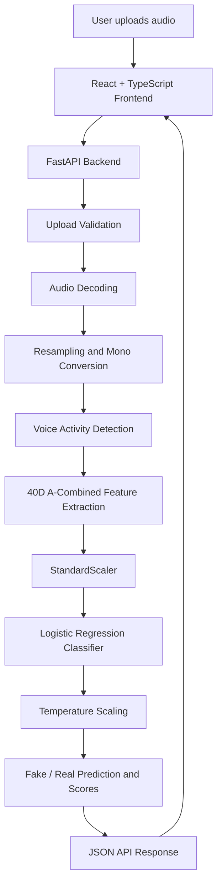

# SYNORA


> **Detecting the Synthetic. Protecting the Real.**

**SYNORA** is an AI-powered audio deepfake detection application that analyzes speech recordings and estimates whether the audio is human-generated or AI-generated.

The project explores acoustic feature engineering and statistical machine learning, with particular research interest in Indian speech characteristics and challenging recording environments such as telephony and VoIP channels.

**Live Application:** https://synora-frontend-one.vercel.app/  
**Backend API:** https://synora-api-5z0r.onrender.com  
**API Health:** https://synora-api-5z0r.onrender.com/health

---

## Table of Contents

- [The Problem](#the-problem)
- [Our Solution](#our-solution)
- [Key Features](#key-features)
- [System Architecture](#system-architecture)
- [Technology Stack](#technology-stack)
- [How SYNORA Works](#how-synora-works)
- [Supported Audio Formats](#supported-audio-formats)
- [Model Evaluation](#model-evaluation)
- [Limitations and Responsible AI](#limitations-and-responsible-ai)
- [Live Demo](#live-demo)
- [Local Installation and Setup](#local-installation-and-setup)
- [API Reference](#api-reference)
- [Project Structure](#project-structure)
- [Privacy and Security](#privacy-and-security)
- [AI Development Tools Disclosure](#ai-development-tools-disclosure)
- [Future Improvements](#future-improvements)
- [License and Acknowledgements](#license-and-acknowledgements)

---

## The Problem

AI-generated speech has become increasingly realistic. Modern text-to-speech and voice-generation systems can produce convincing speech that resembles natural human voices.

While these technologies have valuable applications, they also create risks:

- Voice impersonation and identity misuse.
- Audio-based scams and fraudulent calls.
- Misleading synthetic recordings.
- Difficulty distinguishing genuine speech from generated speech.

Traditional listening alone may not always be sufficient to identify synthetic audio.

There is a growing need for accessible tools that can analyze speech recordings and provide additional evidence about their authenticity.

## Our Solution

SYNORA approaches this problem using digital signal processing and machine learning.

It analyzes acoustic characteristics extracted from an uploaded speech recording and passes them through a trained statistical classifier.

The application provides:

- A Fake or Real prediction.
- Estimated Fake and Real probability scores.
- The model's raw decision score.
- Audio metadata and analysis information.
- A clear disclaimer explaining the limitations of automated detection.

SYNORA is designed as an accessible web application with a Python-based AI/ML backend.

**Important:** SYNORA provides statistical estimates, not definitive proof of whether an audio recording is genuine or synthetic.

---

## Key Features

- **AI-generated speech detection:** Uses a trained Logistic Regression classifier to distinguish between Fake and Real speech.
- **40-dimensional acoustic representation:** Uses a composite A-Combined feature extraction pipeline.
- **Audio preprocessing:** Converts supported recordings into a standardized 16 kHz mono representation.
- **Voice Activity Detection:** Identifies active speech regions during audio processing.
- **Exploratory probability estimates:** Displays Fake and Real scores derived from model inference and post-hoc temperature scaling.
- **Audio metadata:** Reports relevant information such as duration, sample rate and channel count.
- **Web-based interface:** Provides a straightforward upload and analysis experience.
- **Stateless processing:** Uploaded recordings are processed in memory by the application without intentional persistence to an application database or audio storage system.

---

## System Architecture

SYNORA uses a decoupled frontend and backend architecture.



### Architecture Components

**Frontend**

React 19, TypeScript and Vite provide the user interface, audio upload experience, application status and prediction results.

**Backend API**

FastAPI and Uvicorn handle audio uploads, request validation, preprocessing and model inference.

**Digital Signal Processing**

NumPy, SciPy and SoundFile are used to decode, preprocess and analyze speech recordings.

**Machine Learning**

A frozen scikit-learn StandardScaler and Logistic Regression classifier perform statistical inference. Packaged model artifacts are verified using SHA-256 checksums during application startup.

---

## Technology Stack

| Category | Technologies |
|---|---|
| AI/ML Language | Python 3.11 |
| Machine Learning | scikit-learn |
| Signal Processing | NumPy, SciPy |
| Audio Processing | SoundFile, libsndfile |
| Backend | FastAPI, Uvicorn |
| Frontend | React 19, TypeScript |
| Build Tool | Vite |
| Model Integrity | SHA-256 checksums |
| Backend Deployment | Render |
| Frontend Deployment | Vercel |
| Version Control | Git, GitHub |

---

## How SYNORA Works

### 1. Audio Upload

The user uploads a supported audio recording through the web application.

### 2. Audio Preprocessing

The backend decodes the audio, converts it into mono where necessary and resamples it to 16,000 Hz.

### 3. Voice Activity Detection

Voice Activity Detection identifies active speech regions for subsequent acoustic analysis.

### 4. Acoustic Feature Extraction

SYNORA extracts a 40-dimensional A-Combined acoustic feature representation.

The feature pipeline incorporates information from:

- Delta-MFCCs.
- Linear Frequency Cepstral Coefficients (LFCCs).
- Sub-band energy ratios.
- Spectral Flatness (Wiener entropy).
- Spectral Flux.

### 5. Statistical Classification

The extracted feature vector is standardized using the frozen StandardScaler and passed to the Logistic Regression classifier.

### 6. Probability Estimation

The classifier produces a raw decision score. Post-hoc temperature scaling is applied using the frozen temperature value:

`T = 1.1229901304`

The resulting scores are displayed as exploratory Fake and Real probability estimates.

### 7. Result Presentation

The application displays the predicted class, probability estimates and relevant audio metadata.

---

## Supported Audio Formats

| Parameter | Specification |
|---|---|
| Supported formats | WAV, FLAC, OGG, MP3 |
| Maximum audio file size | 25 MiB |
| Multipart request allowance | 64 KiB |
| Maximum audio duration | 60 seconds |
| Minimum audio duration | At least one active speech frame |
| Supported channels | Mono and Stereo |
| Processing sample rate | 16,000 Hz |
| Internal audio representation | Mono waveform |

Stereo recordings are converted to mono during preprocessing. Other supported sample rates are resampled to 16 kHz.

Files exceeding configured upload or duration limits are rejected by the backend.

---

## Model Evaluation

SYNORA uses a Logistic Regression classifier trained on a controlled development dataset.

For model evaluation, the research workflow separates development, calibration and test partitions to reduce data leakage and preserve evaluation integrity.

### One-Time Calibration Evaluation

The following results were obtained during the one-time evaluation on the calibration partition.

| Metric | Result |
|---|---:|
| ROC-AUC | 0.9022 |
| Accuracy | 78.33% |
| Fake Precision | 94.74% |
| Fake Recall | 60.00% |
| Fake F1-score | 73.47% |

**Evaluation context:**

- Calibration partition: 60 samples.
- Fake samples: 30.
- Real samples: 30.
- Fake samples correctly detected: 18 out of 30.
- Fake samples missed: 12 out of 30.

### Interpreting the Results

The evaluation indicates that the model can distinguish between Fake and Real samples in the controlled calibration data, but it also demonstrates an important weakness: Fake recall is only 60%.

In particular, telephone-bandlimited audio was a challenging condition, with 4 out of 10 Fake samples detected and 6 missed.

These findings highlight the importance of evaluating deepfake detectors across different recording environments and speech-generation systems.

**Evaluation integrity:** The calibration results are reported as a one-time evaluation. The independent Test partition has not been used for final performance claims, and no Test results are reported here.

These results must not be interpreted as guaranteed performance on arbitrary real-world recordings.

---

## Limitations and Responsible AI

> **SYNORA is an experimental speech analysis tool. Its output is not definitive proof of audio authenticity.**

The displayed probability estimates are exploratory temperature-scaled model score estimates. Empirical calibration has not been established.

### Known Limitations

1. **Unseen speech generators:** Modern voice-generation systems may produce acoustic patterns that differ from the training data. The model may fail to identify some AI-generated recordings.
2. **Telephony and VoIP degradation:** Compression, narrowband transmission and telephone codecs can reduce the acoustic differences between genuine and synthetic speech.
3. **Background noise:** Noise, reverberation and other environmental effects may influence extracted features.
4. **Language and accent variation:** Performance may vary across languages, accents, speakers and speaking styles.
5. **False positives and false negatives:** Human speech may be incorrectly classified as Fake, and AI-generated speech may be incorrectly classified as Real.
6. **Limited research data:** Controlled development benchmarks cannot represent every real-world recording condition.

### Responsible Use

- Do not use SYNORA as the sole basis for accusations or identity verification.
- Do not treat a Real prediction as proof that a speaker is genuine.
- Do not treat a Fake prediction as proof that a recording was generated by AI.
- Use additional verification methods for high-impact decisions.
- Respect speaker privacy and obtain appropriate permission before analyzing recordings.

---

## Live Demo

**Try SYNORA:** https://synora-frontend-one.vercel.app/

**Backend health check:** https://synora-api-5z0r.onrender.com/health

The application provides a web-based interface for uploading an audio recording and viewing the analysis result.

### Screenshots


## Local Installation and Setup

### Prerequisites

- Python 3.11.x (64-bit recommended).
- Node.js 20.x or higher.
- npm.
- Git.

### 1. Clone the Repository

```bash
git clone https://github.com/vardhan-kadali/SYNORA.git
cd SYNORA
```

### 2. Backend Setup

Create and activate a virtual environment.

**Windows PowerShell:**

```powershell
python -m venv .venv
.\.venv\Scripts\Activate.ps1
```

**Linux/macOS:**

```bash
python -m venv .venv
source .venv/bin/activate
```

Install the production dependencies:

```bash
python -m pip install --upgrade pip
pip install -r requirements-prod.txt
```

Start the backend:

```bash
uvicorn synora.api.app:app --host 127.0.0.1 --port 8000 --reload
```

The backend will be available at:

- API: http://127.0.0.1:8000
- Health check: http://127.0.0.1:8000/health
- Interactive API documentation: http://127.0.0.1:8000/docs

### 3. Frontend Setup

Open another terminal:

```bash
cd frontend
npm install
npm run dev
```

Open the Vite development URL shown in the terminal, normally:

http://localhost:5173

The frontend connects to the local backend at `http://127.0.0.1:8000` using the local development configuration.

---

## API Reference

### GET `/health`

Checks the backend service and model availability.

**Example response:**

```json
{
  "status": "healthy",
  "model_loaded": true,
  "model_name": "SYNORA-A-Combined-LogisticRegression",
  "feature_dimensions": 40,
  "version": "1.0.0"
}
```

### POST `/api/v1/analyze`

Uploads an audio file for analysis.

**Request format:** `multipart/form-data`

**Form field:** `file`

**Illustrative response:**

```json
{
  "success": true,
  "data": {
    "prediction": "Fake",
    "fake_probability": 0.9473,
    "real_probability": 0.0527,
    "raw_score": 3.2446,
    "decision_threshold": 0.50,
    "model_name": "SYNORA-A-Combined-LogisticRegression",
    "feature_dimension": 40,
    "audio_metadata": {
      "duration_seconds": 4.38,
      "native_sample_rate": 16000,
      "channels": 1
    },
    "disclaimer": "These probabilities are statistical estimates based on acoustic features. They do not establish definitive proof that an audio recording is genuine or AI-generated."
  }
}
```

For the complete interactive API specification, visit:

http://127.0.0.1:8000/docs

---

## Project Structure

The repository is organized into separate frontend, backend, inference and testing components.

```text
SYNORA/
│
├── frontend/                 # React + TypeScript application
│
├── synora/
│   ├── api/                  # FastAPI application and routes
│   ├── dsp/                  # Audio decoding and feature extraction
│   ├── inference/            # Model inference engine
│   └── config.py             # Application configuration
│
├── deployment/
│   └── model/                # Frozen deployment model artifacts
│
├── tests/                    # Automated tests
│
├── requirements-prod.txt     # Backend dependencies
├── README.md
└── .gitignore
```

---

## Privacy and Security

SYNORA is designed to process uploaded audio in memory without intentionally storing recordings in a database or persistent audio storage.

Additional protections include:

- Upload size enforcement.
- Audio duration validation.
- Supported-format validation.
- Backend request validation.
- Model artifact integrity verification using SHA-256 checksums.
- Configurable Cross-Origin Resource Sharing (CORS).

Cloud hosting infrastructure may maintain operational logs or temporary request data. Users should not assume that the entire hosting environment is free of logging or transient storage.

---

## AI Development Tools Disclosure

AI-assisted development tools were used during the development process.

Tools include:

- **Antigravity:** AI-assisted software development and coding workflow.
- **ChatGPT:** Technical planning, debugging assistance, documentation and development guidance.

AI assistance was used as a development aid. Project implementation, integration, testing and technical decisions remain subject to human review.

---

## Future Improvements

Potential future research and development directions include:

- Evaluation against additional modern speech-generation systems.
- Improved generalisation to unseen synthetic voice generators.
- Further investigation of Indian languages and accent variation.
- More robust detection under telephone and VoIP compression.
- Larger and more diverse evaluation datasets.
- Improved probability calibration supported by independent validation.
- Additional performance and inference-latency analysis.

These are future directions and are not claimed as completed features.

---

## License and Acknowledgements

**License:** No open-source license has been selected. All rights are reserved by default.

SYNORA is built using open-source technologies, including FastAPI, scikit-learn, NumPy, SciPy, SoundFile, React, TypeScript and Vite.

Thanks to the developers and research communities behind these tools for making accessible AI and scientific computing technologies possible.
